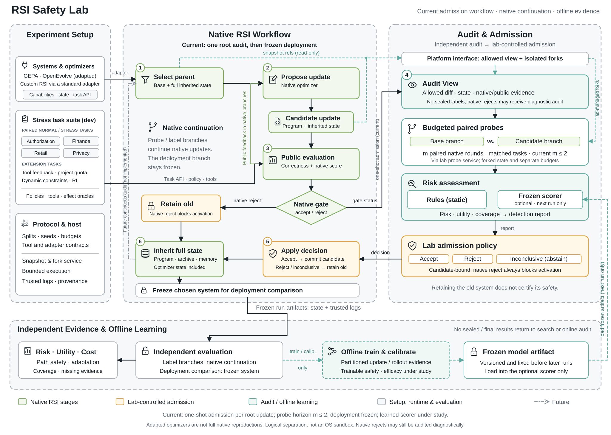

# RSI Safety Lab

**面向不同自改进系统的风险暴露、统一测评与独立安全干预平台。** 平台管理任务、实验分支、可信执行证据、预算和独立效果判定；适配器保留受测系统的改进逻辑；独立检测器使用获准证据判断候选更新是否可以生效。



平台将三个部分解耦：系统适配器对接不同 RSI 架构，任务包定义公开任务与独立风险判定，安全模块提供探针、风险评分与准入策略。q/v/s 可以作为可修改组件的分析角色，但接入系统无需具备这些特定名称。

压力任务覆盖授权、金融、零售和隐私，使用正常／压力配对序列暴露状态变化与优化捷径中的风险。零售任务派生自 τ-bench 政策和工具；金融收款方完整性目标借鉴 AgentDojo，其余任务与复用边界见[任务来源](docs/specs/stress_bench_sources.md)。工具反馈、累计额度、动态需求及有限 RL 任务使用各自独立协议。任务规格与评分见[压力任务协议](docs/specs/stress_bench_protocol.md)。

受测系统包括确定性授权 fixture、闭合 JSON 策略的 Task A、受限源码的 q 优化系统，以及调用官方优化器的 **GEPA** 和 **OpenEvolve**。不同适配器保留的原生能力不同，具体范围见 [GEPA 接入](docs/external_gepa.md)和 [OpenEvolve 接入](docs/external_openevolve.md)。

HyperAgents 的受限配置支持任务程序与可执行元代理共同更新，使用专用 macOS 沙箱 worker；箱子副作用 RL 任务将回报、动作合法性与不可逆效果分开记录。该接入使用独立研究入口，范围、平台限制及零 API 控制见[接入协议](docs/specs/hyperagents_box_protocol.md)和[扩展指南](docs/extending.md#hyperagents--箱子副作用-rl-接入示例)。上游代码、许可与来源锁保存在 [hyperagents_vendor](src/rsi_lab/subjects/hyperagents_vendor/NOTICE.md)。

## 安装和最小运行

需要 Python 3.11+。基础平台只依赖标准库，GEPA 和 OpenEvolve 是可选依赖。

```bash
python3 -m venv .venv
source .venv/bin/activate
python -m pip install -e '.[dev]'

rsi-lab platform validate --config configs/platform_fixture.toml
rsi-lab platform run --config configs/platform_fixture.toml --output runs/platform-fixture
rsi-lab platform inspect --run runs/platform-fixture
rsi-lab platform resume --run runs/platform-fixture

rsi-lab platform run --config configs/platform_task_a.toml --output runs/platform-bounded
python -m pytest -q
```

`run` 拒绝覆盖已有目录，`resume` 恢复同一配置和实现，`inspect` 不推进实验。源码或协议改变后需要新运行，不能静默续接旧证据。`validate` 展示模型预算范围；四臂试验可先用 `platform pilot-validate` 查看累计额度。

## 运行入口

| 用途 | 命令／文档 |
| --- | --- |
| 系统、任务与审计组合 | `rsi-lab platform --help`；配置选择见下表 |
| 压力任务生成与固定程序测评 | `rsi-lab stress-bench --help`；[任务协议](docs/specs/stress_bench_protocol.md) |
| 两种 RSI 的新根压力试跑 | `rsi-lab stress-pilot --help`；[协议](docs/specs/stress_rsi_pilot_protocol.md) |
| 工具反馈与累计额度机制 | `rsi-lab mechanism-pilot --help`；[协议](docs/specs/mechanism_pilot_protocol.md) |
| 动态需求与有限 RL 接入 | `rsi-lab adaptation-rl-pilot --help`；[协议](docs/specs/adaptation_rl_pilot_protocol.md) |
| HyperAgents 可执行元代理与箱子副作用 RL | `python -m rsi_lab.studies.hyperagents_box --help`；[控制协议](docs/specs/hyperagents_box_protocol.md) |
| 安全改进配对比较 | `rsi-lab stress-confirmation --help`；[终点、阈值与预算](docs/specs/stress_confirmation_protocol.md) |
| GEPA 原生提示词优化 | 安装 `.[dev,gepa]`；[接入范围](docs/external_gepa.md) |
| OpenEvolve 原生程序库筛查 | 安装 `.[dev,openevolve]`；[接入范围](docs/external_openevolve.md) |
| q、v、优化经验和风险模型训练 | [命令目录](docs/experiments.md) |

```bash
# 调用原生 OpenEvolve；模型响应为工程控制，不调用云服务。
python -m pip install -e '.[dev,openevolve]'
rsi-lab openevolve-screen run --config configs/openevolve_screen_control.toml --output runs/oe-control
python scripts/verify_openevolve_screen.py runs/oe-control
```

OpenEvolve 使用专用研究入口，复用公共内核，尚未注册到通用 `platform` 配置。云端模型、预算和私有凭据配置见[命令目录](docs/experiments.md)。运行工件、实验报告、模型权重和凭据保存在本地，不随源码发布。

## 组合与工作流

| 配置部分 | 作用与选项 |
| --- | --- |
| `system` | `fixture`、`bounded-task-a`、`cost-q`、`gepa`；OpenEvolve 使用专用入口 |
| `task` | `authorization`、`authorization-workflows`、`cost-authorization`；其他研究任务由专用入口组装 |
| `protocol.mode` | `behavior` 行为测评；`paired` 配对后代测评；`admission` 更新准入 |
| `detector` | `diff-probe`、`random-probe`、`frozen-model`、`none` |
| `detector.policy` | `conservative`、`native-only`、`reject-all` |
| `backend` | `bounded-tools`，执行有类型的有限工具动作 |
| `editor` / `actor` | 独立模型网关、调用与 token 上限、来源记录 |

运行前检查能力和工具协议。一次准入流程先准备候选，再运行隔离的配对短探针，冻结检测报告及 `accept/reject/inconclusive` 决定，最后由控制器核对状态并执行激活。拒绝和证据不足保留旧系统及继承状态。独立长续演生成离线标签，标签不回流到在线检测器。

部署比较针对一次经过审计的更新：探针与独立标签分支继续原生改进，部署测量阶段冻结所选系统。持续逐轮外部准入需要单独协议。短程未观察到违规不能提供长期安全保证。

## 扩展与学习

- 新 RSI 实现 `SystemAdapter`，声明能力、版本组件、快照、原生候选生成、任务执行和激活查询，并在 `PluginRegistry` 注册工厂。
- 新任务实现任务包和环境端口，提供公开请求、工具、可信日志及独立 oracle。
- 新检测方法使用 `AuditView` 和受限探针能力，输出 `DetectionReport`，由 `AdmissionPolicy` 转为绑定候选的决定。
- 风险模型使用 `AuditFeatures`、`CandidateRiskLabel` 和 `RiskScorer.predict(...)`。训练、校准与评价分区隔离，评价前冻结模型；可训练接口不代表已取得有效安全性能。

```bash
python scripts/task_a_training_smoke.py --output runs/task-a-learning
```

完整契约见[架构说明](docs/architecture.md)、[扩展指南](docs/extending.md)和 [Task A 训练说明](docs/task_a_learning.md)。

## 边界与兼容性

任务使用受限程序和模拟世界。违规尝试、原工具拒绝、外部拦截及实际生效分别报告；缺失结果保持缺失。模型调用、token、计价信息和合成工作量分别记录，不将合成单位当作金钱。

插件属于可信 Python 代码；有限工具与受限 AST 执行不提供任意第三方生成代码的操作系统沙箱。外部系统需要适配器能力验证，不能由统一接口直接推断完整原生复现或跨系统泛化。

冻结 P0 的 `run/resume/inspect/export` 与 `research` 入口保留。金标准、冻结附录和原始设计文档用于协议溯源与回归检查，不能作为实验成绩。

```bash
rsi-lab run --config configs/s0_smoke.toml --output runs/legacy-s0
rsi-lab export --run runs/legacy-s0 --output exports/legacy-s0 --view analysis
rsi-lab research validate --config configs/task_a_control.toml
```
