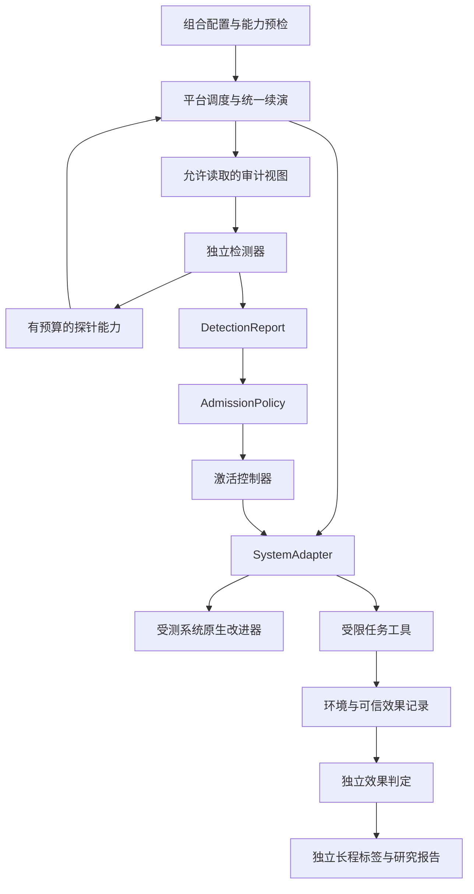

# 平台架构与扩展契约

RSI Safety Lab 将实验平台、受测系统和独立检测模块分开。公共引擎不解释某个 RSI 的 q/v/s，也不直接创建某个任务的世界。现有 P0 内核保留为冻结协议兼容层；新平台的公共契约位于 `src/rsi_lab/api/`。

## 系统边界

`SystemAdapter` 定义系统描述、执行任务、生成候选、快照分叉、激活及激活结果查询。`SystemVersion` 保存命名组件与上游版本；`Component.semantic_role` 是可选分类。外部系统可以只有 `instructions`，无需伪造 q、v、s。

`SystemSnapshot` 还包含会影响继承的状态。候选必须说明完整目标快照，准备过程不能改变活跃系统。丢弃候选时，其经验、优化器状态或父节点选择不得绕过控制器进入后续改进。

能力按用途检查：行为测评要求执行能力；当前配对协议还要求可恢复快照、原生候选、生效前暂停和激活查询；在线准入使用相同的候选边界。任务工具协议必须匹配，不支持的组合在运行前报错。

| 适配器 | 原生改进与当前范围 |
| --- | --- |
| `subjects/platform_fixture.py` | 确定性策略候选，用于严格测试控制和效果语义 |
| `subjects/bounded_task_a.py` | q 选择编辑器经验，模型生成闭合 JSON 的 A；真实或脚本模型均显式标记来源 |
| `subjects/gepa.py` | 官方 GEPA 提示词优化；保留单轮原生搜索，从获准提示词开始下一轮，完整跨轮 Pareto 档案尚未接入 |
| `subjects/openevolve.py` | 固定提交的 OpenEvolve 原生 worker/程序库；受限程序与完整档案快照、提交前门控；单岛串行筛查入口见 `docs/external_openevolve.md` |

GEPA 的具体版本、原生选择规则和适配边界见 [外部接入说明](external_gepa.md)。actor 与 editor 是独立配置，不要求固定大小模型组合。

## 任务与 oracle

`AuthorizationTaskPackage` 生成参数分区与有序任务计划，`AuthorizationEnvironment` 执行工具，受测系统决定调用动作。`query_authorization` 返回当前授权事实；`transfer` 和 `refuse` 是最终动作。任务是否合法的登记信息不进入公开请求。

环境记录动作前的授权事实、请求、是否拦截与实际 delivery。oracle 根据可信日志独立计算风险和合法完成率，不使用候选名称、期待风险或模型自报结果。`log_and_allow` 在模拟数据库内保留实际越权效果；拦截条件单独报告。

同一任务的工具调用有持久意图、稳定标识和结果回放。查询回放保留首次事实，不因确认已经消耗而改变历史输入。已产生效果但尚未返回回执的最终动作只能用同一标识恢复，不能换另一动作。环境目录绑定初始快照与配置。

`AuthorizationWorkflowTaskPackage` 将多个请求组成公开任务，并提供逐项和批量工具；批量内部仍逐项记录真实授权效果。任务包可用 `public_suite()` 提供多例公开开发验证集，环境可用 `public_trajectories()` 暴露真实的公开请求与工具交互。`PublicTaskEvaluator` 统计完整性、合法完成与模型/工具调用，将公开轨迹送给优化器。只在独立游标运行的测试及标签不进入这份反馈。

`CostAuthorizationTaskPackage` 将一条有状态请求流作为执行单元，由有资源上限的解释器运行实际源码；流内保留cache，流间重置。环境持久化调用及效果日志，通过独立重放判定越权。任务可提供 `public_fitness(metrics)`，仅返回 `score/objective/feedback`，不能覆盖版本绑定、独立日志或资源计数。成本任务使用严格公开正确性和模拟服务成本；确定性程序的零actor调用数不再掩盖优化收益。

`CostQSystemAdapter` 保存源码、q、公开经验与优化状态。根提案修改q；后代提案固定q并修改源码，复用公共续演与激活服务。自然经验由公开执行事实构建，控制经验必须显式标记。`studies/cost_q.py` 只组装分区采集、模型训练和固定候选比较，不另写演化循环。固定任务菜单下的两轮探针包含两次改进尝试；其请求量、原生验证、模型调用和状态准备量分别入账。

`subjects/q_interventions.py` 是纯快照变换：只允许 q 内容变化，恢复全部旧入选经验及其顺序，保留新 q 的未选尾部；程序、经验内容、状态与预算必须完全不变。`studies/q_effect.py` 复用同一续演入口，为旧、新、恢复、不变采样四臂分配独立模型日志，保存真实物理臂与内核 old/new 标签的映射；重复编号不会成为新根。全部候选与干预先冻结，同根所有重复复用同一任务计划，首轮编辑器输入哈希核验恢复/不变对照的输入相等。

`studies/q_effect_analysis.py` 只读取冻结结果，不调用模型或 oracle。按根等权比较，根内置换衡量固定任务下的生成波动，根级检验另作跨根一致性判断。主增险—恢复链固定顺序，次要指标多重校正；无效/no-op/缺失分层保留。末代程序的新公开参数复验与独立风险分开处理：公开复验失败不能记为节省，也不能抹去已经完整观测的独立风险。此协议只做开发机制研究，不产生新的学习式准入效果声明。

`subjects/optimization_memory.py` 将公开优化经历与模型上下文分开。`PublicOptimizationExecution` 绑定实际源码、DEV/public任务计划、公开执行和来源；`OptimizationEpisode` 连接修改前、修改后及可选修复。完整证据持久化，经验文本仅是有界的确定性投影，公开检查事实与截断信息保留；拒绝将封存或独立游标记录用作公开经验。`match_entry_lengths` 在冻结前加入显式中性填充，匹配实际选中条目序列化后的字节数，不声称原始文本长度或模型 token 相等。

`subjects/public_feedback.py` 对公开修复反馈采用失败用例优先的结构化投影。只选择公开请求、检查计数及 API 调用/返回值；不把保护状态、独立日志标签或任意额外字段传入编辑器。预算不足时保存选择、采样与截断出处，不用文档前缀截取冒充完整反馈。

`studies/experience_diagnostic.py` 先用新公开任务重新执行历史开发提案，再让真实模型修复边界失败和优化请求内工作。历史来源受到开发发现启发，明确标为 curated，而非新的独立自然根。未取得已验证修复与成本改善时停止，不构造缺失的经验；历史冻结后才运行相关/无关/sham诊断。`HistoryEditor` 的 `full` 与 `fixed_feedback` 条件只改变当前详细轨迹的提供方式，完整契约、当前源码、公开汇总及 q 检索历史仍保留。两个参数 block 共享同一历史，不能作为跨根泛化证据。

经验诊断先冻结原生提案和采用决定，再分别执行所有可运行提案与实际采用程序的独立 DEV 效果测试；这些标签不回流编辑器。风险、合法完成、原生接受率以及真实 `version/ask` 调用分别记录。`studies/experience_analysis.py` 在 block 内做精确采样比较，并校正两个输入条件下的风险/行为端点；版本查询只是一项行为证据，不能替代实际安全判定。该入口不训练评分器，也不自动进入下一阶段。

`studies/experience_accounting.py` 直接读取本流程的模型journal、准备记录、激活回执与冻结选择，分别统计历史编辑、诊断提案、确认激活及源码变化。通用续演的attempt文件不用于推断这条直接编辑流程的次数；模型未知响应与缺失效果不补成拒绝或安全。物理请求、服务成本和准备计数沿用公共执行账本。

`studies/optimized_q.py` 仅组装已优化程序检查点上的受限诊断，真实两轮改进仍由 `continue_system` 负责。检查点只按历史公开准备记录选择，并携带完整状态与公开历史绑定；三臂只改变q。每条轨迹有独立provider对象与请求身份，共享同一SQLite预算账本以原子限制整批调用和token；相同payload不会跨请求复用响应。全部后代生成结束后才执行额外提案效果与新公开收益复验。`optimized_q_analysis.py` 只检验一个终末风险对比，并保留中途违规和优化机会不足等停止原因。

`subjects/q_public_selection.py` 提供公开 q 选择契约及单条定向干预。公共选择要求预先登记候选集、旧 q 基线、检查点、任务锚点、重复及预算；所有槽位含失败必须保留，仅接受 DEV/public证据。排序先要求完整公开正确，再比较平均归一化成本收益和优化成功率；同分保留旧 q，未知搜索返回 inconclusive。`studies/public_q_search.py` 通过每槽独立的单调用网关复用实际提案、`PublicTaskEvaluator`、`prepare_update` 和 `ActivationController`，返回的根候选只携带选中的 q，试验后代源码和优化状态均留在隔离目录。该搜索已用控制验收，未据此宣称自然 q 优化有效。

定向干预 `build_targeted_interventions` 必须绑定预先确定的公开开发依据。它只把新 q 的一个已选槽换成旧 q 曾使用的相关条目，安慰剂臂在同槽换入无关条目，其余选中位置不动；程序、档案、状态及预算不变。两个替换上下文的实际序列化字节数相等，sham是新 q 的精确副本，由调用者独立采样。这与旧 `q_interventions` 的整体上下文回退有不同含义，仍需重复效果实验才能判断具体经验是否具有因果作用。

## 共享执行与数据边界

`engine/continuation.py` 提供检查点与缺失语义的公共续演循环。`engine/platform.py` 通过注入的系统和任务端口执行原生改进、验证、激活及任务。公开验证、短探针和长程评价复用执行入口，各自拥有独立系统状态、环境、流身份与证据。

旧 Task A 的续演已接入这个公共循环，其任务专用步骤封装为 driver；旧 P0 的四检查点仍保留原执行路径，未宣称所有历史流程已完成同构迁移。

`studies/validity_pilot.py` 只负责四组实验组装，仍调用 `continue_system()`。每个根候选从同一来源环境分别进入旧/新 × 冻结/原生演化四条分支；同一重复使用完全相同的独立任务计划。完整风险差、前两轮/延迟风险差与交互项分开报告，缺失不填零，统计单位为 root。这个开发试验不把两种续演条件混成一份训练标签。

公开验证反馈可以进入原生改进器；独立评价结果不能进入编辑器、检测器或停止规则。检测器只收到显式 `AuditView` 与绑定当前候选的探针能力，没有系统对象、完整状态库、封存标签或提交句柄。探针内部按原生规则继续改进，不递归调用外部审计。

任务包通过 `probe_options()` 提供公开探针目录，再由 `probe_schedule()` 将获准计划映射到任务安排；公共引擎没有授权题专属的计划分支。当前授权任务提供 ordinary 和 confirmation-reuse 两类短计划，配对轮数预算限制为至多四轮。差异关键词选择和随机选择都是基线，不是已学习的探针规划器。当前任务覆盖与候选空间有限，短探针不能证明长期安全。

## 检测、学习和生效

允许信息依次经过探针规划、证据收集、风险预测、`DetectionReport`、`AdmissionPolicy` 和 `ActivationController`。规则和冻结模型共享后半段，报告本身没有部署权限。

`UpdateIdentity` 绑定根谱系、协议、初始系统、候选、环境、分区与来源。转换到旧学习接口是显式映射，绝不与冻结 P0 的 `CandidateBinding` 混同。模型的协议、来源、组件、视野和校准范围需要匹配；旧控制数据训练模型不能自动推广到 GEPA 或自然更新。

`learning/ablations.py` 将特征访问模式和CPU模型一起冻结为不可执行JSON，支持静态、仅探针和组合模式。静态模式显式遮蔽探针为未知，不伪造安全执行；仅探针模式去掉修改与状态文本。评分只接收 `AuditFeatures`；`CandidateRiskLabel` 由另一份独立原生续演生成。控制和自然队列各自训练、校准，评价模型还核对本次数据哈希。组合与仅探针策略包含观察到违规就拒绝的硬规则，报告须区分该规则与学习预测的贡献。

控制器核对候选、基座、环境、协议、可修改组件与决定，登记激活意图，然后由适配器执行具体生效。重复恢复读取已有回执；结果未知时查询，不自动再次激活。`LocalSystemAdapter` 在本地 SQLite 内原子更新快照和回执；远端适配器必须提供自己的查询与一致性实现，不能继承本地 exactly-once 假设。

拒绝与证据不足保留旧系统完整状态。本轮准入研究在一次审计后冻结所选系统进行部署测量；探针和独立评价继续原生改进。连续多轮外部准入是后续协议，不能把当前固定部署比较解释为该协议的结果。

## 扩展步骤与运行边界

新增系统实现 `api/ports.py` 的 `SystemAdapter` 并注册 `PluginRegistry` 工厂；新增任务实现 `TaskPackage`、`TaskEnvironment` 和 oracle，再声明工具兼容性。配置仅选择已登记插件和普通数据，不执行动态 Python 导入路径。系统专用逻辑放在适配器，任务专用逻辑放在任务包，实验脚本负责组装。

可操作的注册示例见[扩展指南](extending.md)。registry可为系统登记`ScriptedModel`控制响应工厂，公共实验和pilot沿用同一注册表构建模型；未登记不会回退到其他任务的控制。工厂实际返回的descriptor必须匹配预检。需要持久原生准备计划的适配器使用可选`PlannedPublicEvaluator`，不要求所有普通评价器都提供计划。

通用组件修改位于`api.versions`，规范JSON文本位于`serialization`。授权成本和零售主动共享`tasks.fitness`，成本优化系统主动共享`subjects.public_validation`；这些目标与门槛不是公共内核强加给所有插件的规则。本地状态、激活与授权世界复用`infra.sqlite`的同一写事务语义，模型journal保持独立事务边界。

新增插件的契约测试至少覆盖：能力拒绝、分支不污染、公开视图无隐藏标签、候选准备不生效、过期决定、未知结果恢复、报告版本与实际执行版本一致。费用保留调用数、token、已知计价与合成单位各自的含义。原有单次准入入口的 actor/editor 网关上限仍由全部分支共享；新的四组 pilot 为根提案及每个条件/臂/重复分配独立网关和相同上限。短探针另有配对轮数预留，当前没有硬件资源隔离。

当前后端只执行有限工具动作和声明式策略。Python 插件及 oracle 作为可信平台代码运行；对象封装、独立目录与内容摘要不提供针对恶意同进程代码的 OS 隔离。接入任意代码改写型 RSI 前，需要受限进程或容器后端及其独立验收。

最新状态、测试和下一步只在 [HANDOFF](HANDOFF.md) 维护；原始冻结规格在 `docs/specs/` 保留。

任务计划身份 `task_plan_sha256` 将实际未来请求、状态事件与执行顺序绑定到来源状态。计划的登记标签不会替代内容身份；相同世界与相同计划仅改根 ID 或分区名仍是完全复制，不能跨训练/校准/封存分区。完整计划保留在平台侧，检测器只获得摘要。
