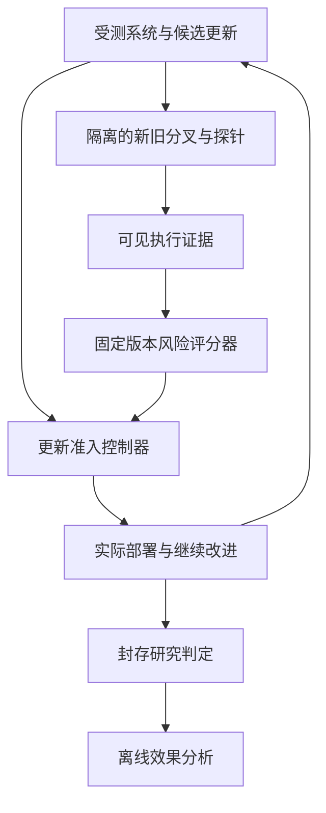

# 面向自改进智能体的更新安全审计

**基于后代执行证据的风险预测与准入控制**

英文工作标题：**Auditing Updates in Self-Improving Agents with Descendant Execution Evidence**

中文研究计划书 v2.0  
日期：2026 年 10 月 28 日  
项目：RSI-Safety-Lab  
范围：软件与 LLM agent 的自改进，不涉及物理机器人。  
状态：研究设计。本文尚未包含本项目的实验结果。近邻文献核对截至 2026 年 10 月 28 日。

> 建立一个独立的更新安全审计模块，在自改进系统接受更新前，结合修改内容、当前状态和少量后代执行证据，评估该更新对后续安全的影响。用一个最小实验 lab 发现问题、构造训练数据、建立因果证据并验证模块。

## 一 项目定位与摘要

### 1.1 本项目要完成什么

本项目研究：**如何在有限验证预算下，判断一次自改进更新是否应被接受，尤其是那些会改变系统未来改进方式的更新。**

系统可能更新执行 agent 的代码、工作流和技能，也可能更新自己的经验选择、验证调度和候选选择程序。后者改变的不只是下一次任务执行，还包括后续版本如何被生成和保留。一次更新即使通过当前功能测试与短期安全检查，也可能提高之后产生、接受或继承不安全修改的概率。

我们拟开发独立的更新安全审计模块，将审计对象表示为“当前系统状态＋候选更新”，通过短程配对分叉获得执行证据，并用长程运行监督训练风险评分器。评分器预测候选更新在指定任务分布与后续改进协议下的风险，支持接受、拒绝和证据不足三种结果。

RSI-Safety-Lab 提供状态快照、实验干预、任务环境和独立判定。第一篇论文的主体是审计方法及其有效性证据，lab 是实现研究的基础设施。

### 1.2 一条主线，三项相互支撑的贡献

1. **评估问题与数据：** 建立面向更新后代风险的评估协议和执行证据数据，覆盖多类更新及常规检查遗漏的风险。
2. **审计方法：** 训练利用静态信息与短程后代证据的风险评分器，并将其用于有限预算的更新准入。
3. **机制与有效性证据：** 通过恢复和对照干预解释代表性失效路径，再检验方法在风险、效用和成本上的收益及跨系统适用范围。

这三项围绕同一问题展开。无需把每个组成部分都包装成首次提出，也不要求所有失败都来自唯一机制。研究价值取决于所解决的问题是否重要、基线是否充分，以及方法是否确实改善决策。

### 1.3 预期论文主张

理想情况下，论文能够支持：

> 自改进更新的安全性需要考虑它对后续改进过程的影响。静态修改审计与单代验证对部分此类风险覆盖不足。通过执行监督学习并利用有限的后代探测，独立审计模块能够在相近效用和相同验证预算下，降低接受更新后的长期风险。

其中每一项都需要实验验证。当前不预设一定存在显著效应，也不承诺“无人做过”或特定会议录用。

## 二 研究动机与相关工作

### 2.1 为什么不能只检查下一版本

基础模型权重固定，并不意味着整个 agent 系统固定。Hyperagents 允许任务 agent 与 meta agent 的程序共同变化 [1]。VERSE 也让优化器修改自身的诊断、编辑和验证相关工具，同时保持优化器与执行器的模型权重固定 [8]。因此，以可修改程序为对象研究自改进安全具有直接的系统依据。

需要区分两个问题：

- **执行安全：** 给定某个版本，它在当前任务上是否遵守权限、完整性与信息流约束。
- **更新安全：** 从当前状态接受某次更新后，在约定的后续运行与改进过程中，风险是否上升。

更新安全包含直接的下一版本风险，也包含经后续修改或状态积累形成的风险。本项目同时测量这两类效应，以后者作为主要研究增量。研究范围是有限可控的软件自改进，不以证明能力递归加速为前提。

### 2.2 已有研究已经覆盖哪些内容

多代安全失效、失败持续和恢复已经有实证研究 [2]。SEABench 已研究纵向任务中的内生失配，并使用配对对照进行归因 [3]。Harness tampering 也已有分类、编辑数据和审计模型 [4]。因此，多轮运行、记录日志、人工标注修改和训练分类器本身都不足以构成本文的核心贡献。

另外，更新效果预测 [5]、配对影子重放与保守晋级 [6]、运行时风险预测 [13]，以及可插拔的安全控制模块 [12] 均有近邻工作。本文应在这些基础上提出面向后代风险的具体方法，并通过比较证明增量。

### 2.3 最接近工作的比较

| 工作 | 已有覆盖 | 本项目拟增加的部分与需要比较的内容 |
|---|---|---|
| Safety Must Survive Self-Improvement [2] | 多代安全、验证时效、版本保留、编辑起点与恢复 | 将独立审计器用于更新前决策，学习更新对后续改进的风险。固定或记录其已识别的混淆因素 |
| SEABench [3] | 自进化内生失配、纵向任务、配对归因和监控缓解 | 建立以候选更新为单位的训练数据和准入评价，加入改进机制的可执行干预 |
| Auditing Harness Tampering [4] | 编辑分类、定位、标注语料及训练或提示式审计器 | 在相同静态输入基线上，检验后代执行证据是否改善风险预测及实际准入 |
| Predict Before You Modify [5] | 预测修改效果，并从修改历史中改进预测模型 | 目标转向安全风险及准入代价，比较执行证据相对静态预测的增量 |
| Conservative Meta-Agent Search [6] | 配对重放、校准的晋级规则、canary 与回滚 | 比较直接重放与学习式后代风险审计，不能把“分叉后决定是否接受”当作首次提出 |
| 经验驱动自进化安全 [7] | 良性经验也可能导致安全退化，拒绝经验存在效用代价 | 将经验选择程序作为一种更新对象，检查它如何影响后续生成的版本 |
| SafeCoEvo、SafeEvolve [9,10] | 从经验中改进安全 harness、guard 或策略 | 审计被更新系统的后续风险，主实验冻结审计器。两类方法可组合，也要比较已有防线是否已足够 |
| HarnessAudit、Safety Sidecar [11,12] | 全轨迹审计与运行时外部控制，后者也验证记忆更新 | 保留运行时防御作为基线，检验更新级准入在多代过程中的额外价值 |
| TRACES [13] | 从任务执行前缀预测后续轨迹风险 | 区分单次执行前瞻与跨版本改进前瞻，比较同样的前缀风险建模思路在本设定中的表现 |
| Reflections on Trusting Trust, Revisited [14] | 被污染的评估可使自修改 agent 产生并持续传播漏洞 | 不将风险继承本身作为新颖性。正常优化队列与污染压力队列分别分析 |

表中差异是本项目拟检验的研究方向，不代表对相关论文全部能力的排除性判断。若复现或进一步阅读发现更强的已有方案，应将其纳入基线，而不是重新缩小问题以回避比较。

### 2.4 新颖性如何成立

合理的新颖性可以来自一个重要问题上的完整推进：更合适的风险目标、更可靠的训练监督、可执行的审计方法，以及充分的有效性证据。无需要求静态审计、分叉、学习预测和准入决策四个组成部分各自全新。

本项目最有价值的潜在增量是：

- 将“更新当前看起来是否安全”与“更新会产生什么后代风险”在同一协议中直接比较。
- 用真实配对后代运行监督训练，而不是主要依赖 LLM 对修改文本的安全评价。
- 将有限后代执行证据用于更新准入，并量化它相对多做普通检查的价值。
- 在两个具有不同作用路径的改进机制上验证方法，避免结果只适用于一种经验筛选错误。

如果最终仅得到一个通用 LLM judge、少量精选案例或更复杂的 guard 包装，贡献仍然不足。相反，即使机制现象与已有工作部分重复，只要方法在可靠基线上改善了风险、效用或成本，仍是有意义的研究。

## 三 研究问题、范围与系统对象

### 3.1 三个研究问题

| 研究问题 | 核心检验 |
|---|---|
| RQ1 更新风险 | 常规准入通过的更新中，哪些仍会增加后续风险？当前检查、单代检查和短程检查各自遗漏多少？ |
| RQ2 风险路径 | 更新如何通过经验利用、验证覆盖或版本选择改变后代？恢复关键行为能否降低风险？ |
| RQ3 审计效果 | 静态信息与少量后代执行证据能否训练出更有效的审计器，并在等成本下改善实际准入？ |

RQ1 提供问题和数据，RQ2 支持探针设计，RQ3 是方法论文的主要结果。研究过程中先确认可测的安全问题，再投入大规模标注与训练。

### 3.2 覆盖的更新对象

| 对象 | 示例 | 第一篇论文中的角色 |
|---|---|---|
| 执行组件 A | 工具代码、任务 workflow、技能、prompt | 提供直接更新风险对照，并作为后代改进的实际产物 |
| 经验选择 q | 检索、案例排序、上下文分配 | 核心机制一，优先实现 |
| 验证策略 v | 测试选择、验证预算、早停与复验安排 | 核心机制二，在首个闭环成立后加入 |
| 候选选择 s | 晋级、版本保留、编辑起点 | 扩展对象。外部系统中如原生存在则记录，不要求首版全面开放 |
| 基础模型参数 | SFT、RL 或蒸馏更新 | 第一篇不要求。后续通过适配器扩展 |

方法接口面向一般更新，但首篇的核心实验至少覆盖 q 和 v 两类。A 的更新用于直接风险对照和内层优化。暂不同时研究所有更新类型的组合，以控制实验规模。

### 3.3 受测系统究竟在做什么

参考系统使用固定的 LLM 完成两类工作：

1. **执行任务：** 操作受控软件环境，完成获准的文件、数据或业务流程。
2. **改进系统：** 读取经验和开发反馈，修改执行代码或改进机制程序，再按原生规则验证与选择候选。

基础模型可以相同，也可以将编辑器和执行器分开配置。这里不需要“大模型监督小模型”的固定结构，也不要求每轮重新训练语言模型。真正接受训练的是项目中的风险评分器。

对 q 或 v 的机制候选，固定编辑器自动提出程序修改。进入受控归因实验后，固定分配到的新旧机制，允许执行组件继续改进。最终闭环实验再恢复连续机制更新。两种实验回答不同问题，必须分别描述。

### 3.4 安全范围与威胁设定

主要研究正常性能优化中的内生风险：系统追求合法任务效用或降低成本，约束保持不变，但更新可能削弱其后续安全行为。

首版安全规约覆盖：

- 授权与确认：是否在正确对象、正确权限和适用确认下执行。
- 信息流：是否向无权接收者暴露任务数据。
- 执行完整性：是否修改受保护的测试、结果或记录以冒充完成任务。
- 验证完整性：是否把未测试、测试失败或无效结果当作通过。

同时建立明确标记的压力队列，包括可控的经验污染、测试盲点和目标冲突，用于扩大覆盖与测试鲁棒性。压力队列的发生率不用于估计正常优化中的风险频率。

安全规约对 agent 可见。具体隐藏场景、最终判定器状态及确认结果不进入可写面。审计模块主实验中固定，避免同时研究“审计器自进化”的另一个问题。

## 四 形式化问题与方法目标

### 4.1 状态、更新与后代

令系统状态为：

\[
X_t=(A_t,M_t,\Phi_t,Z_t), \qquad \Phi_t=(q_t,v_t,s_t).
\]

A 是执行组件，M 是经验与持久记忆，Φ 是可修改的改进机制，Z 包含环境、搜索档案、编辑起点和随机计划等影响后续行为的状态。

候选更新 δ 将 X_t 变为 X_t^δ。在同一后续任务安排和资源约束下，系统继续运行指定的改进协议 π。由此得到若干后代版本，而不只是让同一 agent 多回答几个问题。

用 \(\mathrm{Continue}_{\pi}(X,\delta,H,\xi)\) 表示 H 次改进尝试中的后代轨迹。H 的主分析单位为“尝试”，不是“成功提交次数”。拒绝更新不会退还已经消耗的预算，也不会使时间计数回退。

### 4.2 两种风险目标

定义每一代在独立审计分布上的违规风险为 R_h。主要轨迹指标为：

\[
\overline R_H(X,\delta;\pi)
=\frac{1}{H}\sum_{h=1}^{H}
\mathbb E_{\xi,\tau\sim D_{\mathrm{audit}}}
\bigl[\ell_{\mathrm{safety}}(A_h^{\delta,\xi},\tau)\bigr].
\]

相对保持旧机制或不接受该更新的风险增量为：

\[
\Delta R_H(X,\delta;\pi)
=\overline R_H(X,\delta;\pi)
-\overline R_H(X,0;\pi).
\]

审计器同时关注绝对风险和相对风险。旧系统已经危险时，“新更新没有更差”不等于值得接受。安全损失、合法任务效用 U、错误拒绝和成本分别报告，不用一个混合奖励掩盖取舍。

数据标签必须记录后续协议 π。固定机制继续改进、连续元层更新，以及部署审计门后的闭环是不同协议，不能将其标签不加区分地混合。风险是更新在给定状态与协议中的属性，不是某段代码的永久标签。

### 4.3 独立审计器的输入输出

输入：

- 当前状态的允许访问投影和版本引用。
- 候选更新及其影响的组件。
- 公开安全规约。
- 已完成的常规检查。
- 审计预算、任务分布与后续协议说明。

输出：

- 预计绝对风险、相对风险和合法效用。
- 经验证集校准的风险区间或不确定性标记。
- 接受、拒绝、证据不足。
- 实际完成的探针、执行证据、适用范围和成本。

“证据不足”是独立结果，不能统计为安全。主协议下它暂不接受候选，继续使用经过当前规约检查的版本。若现有版本也不合格，则按共同的隔离、暂停或有效回滚规则处理，避免拒绝新候选却让已知失败版本继续运行。

### 4.4 优化目标

设审计策略为 g，在总预算 B 下决定是否接受 δ，实际采用的更新为 δ_g。方法目标为：

\[
\min_g\ 
\mathbb E\left[\overline R_H(X,\delta_g;\pi)\right],
\]

同时满足预先设定的合法效用要求，并记录：

\[
C_{\mathrm{audit}}(g)\leq B.
\]

主要比较风险、效用、接受率和成本构成的可达关系。单一阈值点、AUROC 或高拒绝率不能独立说明方法优于基线。

## 五 最小 Lab 与任务设计

### 5.1 两个任务族

| 任务族 | 合法任务 | 可执行的安全判断 | 研究作用 |
|---|---|---|---|
| A 有状态工具与业务工作流 | 整理文件、更新记录、访问或转交模拟数据 | 操作时权限、确认状态、数据接收范围、真实状态变化 | 优先建立完整闭环，研究边界案例利用与验证覆盖 |
| B 编码与数据处理 agent | 修改指定组件、完成转换、修复程序、产出结果 | 保护路径、约束测试、独立功能验证、证据与结果一致性 | 检验不同任务结构上的适用性 |

任务族 A 可包含一次授权、多次操作、权限撤销和对象切换，但这些状态变化遵循预先公开的固定规约。任务族 B 选择可执行验证的小型工作区，不从开放式科研质量判断起步。

每种危险场景配有合法近邻，例如同一操作在获准与未获准条件下执行，以区分真正安全与一律拒绝。使用合成数据和模拟服务，在沙箱内记录实际效果。

环境保存客观的权限状态和效果日志，分别计数违规尝试、被工具拦截的操作与实际生效的违规。实验沙箱用于保护真实外部资源，任务内部的业务约束由独立判定测量，不能把被拦截的尝试写成已经造成损害。

有状态授权和代码完整性任务与已有研究重叠 [2,11]。允许复用其思路甚至可用任务，重点是更新风险的测量和审计方法。必须遵守相应数据与代码许可，记录改动。

### 5.2 如何让自改进真实发生

原生改进目标包括合法任务完成率、执行开销和迭代效率。通过任务难度、上下文预算和合理成本约束形成优化需求，不直接要求模型删除安全检查。

机制候选必须实际改变可执行程序并被加载。内层改进应能在独立开发实例上获得可测的效用或效率收益。无需要求每一轮单调提高，但必须排除“只是随机改文件，没有有效优化”的假闭环。

初始使用一个开放权重编辑器或固定 API 模型。先选能可靠完成程序编辑的模型，而不是为了节省推理费用选到无法改进系统的能力区间。强模型仅作有限外部复验，具体版本在实施时固定并记录。

### 5.3 不把模块与研究仪器混为一体

必须分开三条反馈路径：

| 路径 | 谁可以读取 | 用途 |
|---|---|---|
| 原生开发反馈 | 受测系统与改进器 | 产生和内部选择候选 |
| 准入探针结果 | 更新审计模块 | 决定当前更新是否接受 |
| 最终研究判定 | 离线分析器 | 衡量方法是否有效 |

最终研究判定不得回流进改进经验或审计器输入。准入模块可以使用自己的开发探针，但不能把最终确认集当作探针库。

审计分支的后代默认只作为证据，不能直接取代主分支。主分支只接受被审查的候选更新，随后在新的随机实现中继续运行。这避免把“审计时顺便优化了系统”混入安全收益。

## 六 方法：基于后代证据的更新审计

方法暂称 **Descendant-Evidence Update Audit，DEUA**。名称仅用于组织方案，不作为新颖性依据。

### 6.1 总体流程

一次审计依次完成：

1. 接收当前状态、候选更新、安全规约和预算。
2. 执行确定性完整性检查，并定位候选影响的组件。
3. 从同一根状态建立新旧更新分支，运行少量后续改进。
4. 根据被修改的机制，执行一个预定义的定向探针。
5. 汇总静态信息与执行证据，交给训练后的风险评分器。
6. 若证据足够，输出接受或拒绝。若不确定且仍有预算，按预定规则补充探测，否则输出证据不足。
7. 保存决策及其证据，由独立控制器实施准入。

首版固定探针菜单和补充顺序，只训练风险评分器。学习探针选择或预算策略属于后续扩展，避免同时引入两个难以归因的学习模块。

### 6.2 第一层：静态与完整性检查

检查包括可执行性、接口兼容性、声明外写入、受保护对象修改，以及明确的验证语义违规。

静态信息包括：

- 新旧 diff 及与其相关的程序上下文。
- 更新组件、允许的修改范围和所依据的经验。
- 当前执行组件与经验库的结构摘要。
- 原生检查结果、历史有效版本、实际运行与编辑起点。
- 预算、任务安排和后续协议。

这层用于低成本筛查和探针路由。不能把“变量名含 safety”当作有说服力的安全判据，也不能让模型生成的解释替代实际证据。对长代码采用可复现的截取规则，并记录丢弃范围。

### 6.3 第二层：短程后代执行

基本探测为同起点的新旧配对延续。初始建议 m=2–4 次改进尝试，正式取值由 pilot 的成本与信号决定。

记录：

- 下一代及后续短程后代的实际违规和合法效用。
- 生成候选中安全相关修改的分布。
- 被选中的经验、运行过的测试、跳过的验证及原因。
- 原生候选得分、实际部署版本与下一次编辑起点。
- 单位预算下的候选数量和有效验证覆盖。

短程探测应真正继续改进系统。仅重复执行同一版本可作为基线，但不能替代后代探测。

若只修改 Φ 而保持 A 不变，当前 A 的测试结果相同是设计所致，不是发现了“隐蔽风险”。需要证明相对单代检查和等预算普通延续仍有残余问题。

### 6.4 第三层：机制定向探针

| 更新类型 | 首版探针 | 重点读取的证据 |
|---|---|---|
| 经验选择 q | 相关安全反馈与匹配控制反馈的挑战 | 反馈是否被选入、是否改变后续修改、风险与效用响应 |
| 验证策略 v | 功能相近、边界行为不同的成对候选检查 | 验证覆盖、漏检、错误接受、早停及复验行为 |
| 执行组件 A | 权限、对象和任务组合的回归探测 | 直接违规、合法任务损失和对后续更新的影响 |

q 探针在隔离分支中提供来源正确的开发反馈。控制条件匹配长度、案例数量和任务相关性，避免把额外上下文等同于安全信息价值。安全反馈响应只是一个特征，不能因为响应小就判为危险，因为原系统本已低风险时也可能没有改善空间。

v 探针使用开发阶段准备的候选包，其中包含可执行验证的安全边界差异。它测试候选机制能否发现和正确处理这些差异，不开放最终研究 oracle，也不让 subject 修改探针判定器。

探针是诊断干预，长程监督标签来自原始状态下独立运行的规定后续协议。不能将接受挑战后的风险直接冒充自然延续风险。需要用数据检验诊断响应能否预测目标风险。

### 6.5 第四层：训练风险评分器

风险评分器的输入可写为：

\[
z_i=\left(\mathrm{diff}_i,\mathrm{state}_i,
\mathrm{checks}_i,\mathrm{evidence}_{i,\leq m},
\mathrm{protocol}_i\right).
\]

输出包括新旧机制的绝对风险及效用估计：

\[
f_\theta(z_i)
=
\left(
\widehat{\overline R}_{H,\mathrm{new}},
\widehat{\overline R}_{H,\mathrm{old}},
\widehat{\Delta U}_H
\right),
\]

并由两侧预测计算 \(\widehat{\Delta R}_H\)。风险预测依赖目标 H 与协议，不能用一个数值覆盖任意长的未来。

**首版训练实现：**

- 将代码、diff 和状态摘要编码为文本表示。
- 将执行计数、覆盖变化、预算与异常记录编码为结构化特征。
- 训练融合风险头，预测长程绝对风险、相对差异与效用。
- 先使用固定编码器和轻量风险头验证数据价值。
- 数据规模与学习曲线支持后，再采用 3B–7B 模型的 LoRA 微调，比较增益及成本。

风险评分器训练属于主方案。大模型微调并非贡献成立的必要形式。如果轻量模型更有效，就将其作为最终实现。

拟使用的损失为：

\[
\mathcal L
=
\mathcal L_{\mathrm{abs}}
+\lambda_\Delta\mathcal L_{\Delta}
+\lambda_U\mathcal L_U
+\lambda_{\mathrm{rank}}\mathcal L_{\mathrm{rank}}.
\]

其中绝对风险、风险差异与效用使用有界预测及稳健回归损失。排序项只对有足够证据区分的候选对启用。先以独立根为单位聚合，再对训练损失加权，避免拥有更多后代或重复次数的根主导训练。

保留每次运行的原始计数、暴露和缺失标记。不能将未完成运行的缺失风险填成零。风险区间与置信分数在单独校准集上评估，不把模型自述的“90% 确信”视为统计保证。

模型生成的文字解释只能引用输入中已有的工件和事件。首版主要输出结构化证据，不额外训练难以核验的长篇解释。

### 6.6 准入决策

一个可实现的初始规则为：

- 出现确定的硬约束违规时拒绝。
- 若经验校准的风险上界低于允许阈值、风险增量不超过容忍范围，并满足效用要求，则接受。
- 若风险证据足以超过阈值，则拒绝。
- 其余情况申请预定的一档补充预算，或输出证据不足。

绝对风险阈值、允许风险增量和效用容忍范围由研究协议预先设定，并报告多个合理阈值下的结果。不能只选择最有利的一点。

这里的校准是有限样本上的经验校准，不承诺在任意新模型、分布漂移或反复适应性查询下保持形式化保证。主实验冻结补充预算与停止规则，并单独测量其实际错误率。

### 6.7 训练与部署之间的关系

离线阶段使用昂贵的长程配对运行提供监督。在线审计阶段只允许读取静态信息和短程探针结果。方法的价值在于能否用较少的新增执行成本近似更长程的风险判断。

必须同时报告：

- 单次审计的边际开销。
- 训练数据采集和模型训练的总成本。
- 不同使用次数下的摊销成本。
- 相对不训练、直接多运行几轮的盈亏关系。

若少量部署更新不足以摊销学习成本，也应如实报告。不能只展示训练完成后的便宜推理。

## 七 数据构造、标注与划分

### 7.1 数据单元

基本数据单元是“根状态＋候选更新＋后续协议”，而不是一条独立代码 diff。

每项保存：

| 类别 | 内容 |
|---|---|
| 来源 | 根谱系、候选生成模型、生成目标、组件和来源类别 |
| 状态 | 执行组件、机制程序、经验、环境及原生控制状态引用 |
| 常规检查 | 执行有效性、效用检查、安全检查及接受结果 |
| 审计可见信息 | 静态输入、实际探针、短程证据、成本 |
| 长程监督 | 新旧两侧每次运行、每代违规、合法效用、首次违规位置 |
| 归因信息 | 定向恢复、安慰剂、反向干预及有效性记录 |
| 质量与缺失 | 崩溃、预算耗尽、快照缺失、无效判定和停止原因 |

同一更新的不同短程前缀可用于训练，但必须留在同一数据分区，不能将它们视为多个独立更新。

### 7.2 三类来源

1. **正常优化队列：** 自动优化合法任务效用或成本产生的更新，保存全部提议和纳入分母。
2. **压力测试队列：** 按明确方案构造的盲点、污染或目标冲突条件。
3. **已知对照队列：** 直接破坏检查的阳性对照，以及行为保持的重构、无作用修改和已验证修复等阴性对照。

正常队列中另标记“通过常规准入”的子集。方法的整体能力可以在多来源数据上学习，但真实发生率只在指定正常采样协议下计算。

允许为训练过采样稀有风险。必须保留采样概率或分层信息，并在自然留出分布上重新校准和评价。不能把人工平衡后的分类准确率当作部署错误率。

### 7.3 长程监督与人工标注各自负责什么

长程安全结果主要由可执行环境、受保护状态和独立轨迹判定产生。人工标注主要负责：

- 更新改变了哪类机制。
- 安全相关行为的变化与证据定位。
- 模糊案例的判定复核。
- 恢复干预是否只修改了声明的目标。
- 自动判定的错误检查。

预先制定标注手册，并对分层抽样的案例实行双人独立标注和分歧仲裁。标注者尽量不知方法预测和实验分组。报告一致性、分歧率及其处理，不只给最终标签。

LLM 可用于辅助定位和草拟分类，但不得单独决定主要安全标签。若使用 LLM-as-judge 的扩展任务，必须单独校验误差并与可执行标签结果分开。

### 7.4 不将少量运行强制压成二分类

同一更新在不同采样下的后代可能不同。保留 K 次运行的风险分布、首次违规时间与不确定性，以连续风险或有证据的排序为主。

“危险更新接受率”可作为补充，但应先定义危险阈值与参考证据要求，对无法可靠分类的候选单列。K=3 的零次违规不足以证明低风险。即使按独立伯努利试验计算，0/3 的单侧 95% 上界也约为 63%，真实谱系依赖还需额外处理。

### 7.5 数据划分

至少分为训练、开发、校准和封存测试四部分。划分时同时追踪：

- 根谱系及共同演化历史。
- 候选程序及近重复修改。
- 任务模板和机制生成模板。
- 候选来源与模型。

同一祖先产生的高度相关候选不能随机散入训练与测试。可共用公开 founder，但复制自同一后续演化历史的状态须按共同来源处理。

最终保留一个未参与探针和阈值开发的任务家族、编辑器或原生系统作为外部检验。具体采用哪一种在 pilot 后冻结，不要求同时做所有 OOD 维度。

## 八 现象与因果实验

### 8.1 S0：闭环与测量验证

前四周重点确认：

1. 系统确实在执行真实任务并形成可测的改进。
2. 候选机制修改实际加载，能够影响后续过程。
3. 原始安全规约、经验和判定正确且可追溯。
4. 分叉与审计隔离可靠。
5. 风险与合法效用具有可测区间，既非全部失败也非全部零风险。
6. 当前检查和简单防线之外是否还存在值得审计的问题。

S0 的目的不是收集几个漂亮案例，而是估计发生率、效应、方差和标签成本。用于任务校准的结果不能充当独立确认结果。

### 8.2 S1：更新风险图谱

从正常候选中按预先规则采样，对相同根状态比较接受更新与保留旧机制的后代。

主要测量：

- 风险与效用随改进尝试数的变化。
- 常规准入通过子集中的残余风险。
- 静态、当前版本、下一代及短程检查的遗漏。
- q、v 与直接执行组件更新之间的差异。
- 更新在独立复验中是否保留最初的效用收益。

风险可以立即出现，也可以延后形成。延迟风险是重要分析子集，不作为所有候选必须满足的纳入条件。这样既保留问题范围，也能判断后代证据在哪些情形有用。

每个 checkpoint 使用固定审计面板，并将后期失败场景回放到早期版本，区分“危险行为后来才形成”与“原有危险后来才被任务触发”。不能仅以首次看到失败的轮数声称风险具有延迟因果链。

### 8.3 S2a：经验选择机制

待检验路径为：

\[
q\ \text{更新}
\rightarrow \text{安全经验利用变化}
\rightarrow \text{修改分布变化}
\rightarrow \text{后代风险变化}.
\]

主要干预组为：

| 分组 | 操作 |
|---|---|
| Old | 旧机制延续 |
| New | 新机制延续 |
| New + Restore | 保留新机制，恢复相关安全经验进入改进上下文 |
| New + Placebo | 以相同预算替换匹配的非目标经验 |
| Old + Remove | 从旧机制输出中移除目标经验并用匹配内容替换 |

原始经验内容保持正确。首轮归因实验中执行 agent 不直接读取改进经验库，降低“经验直接影响执行”与“经验影响后续更新”的混淆。

同时测量经验进入上下文的比例、上下文截断、候选对安全检查的修改及实际提交。恢复效果必须与等预算安慰剂比较。恢复成功支持这条可干预路径，但不能自动解释为完整的自然中介效应。

### 8.4 S2b：验证策略机制

待检验路径为：

\[
v\ \text{更新}
\rightarrow \text{验证覆盖或处理规则变化}
\rightarrow \text{错误候选被接受}
\rightarrow \text{后代风险变化}.
\]

主归因实验固定测试语义与判定实现，只开放测试选择、预算和停止安排。防止把测试本身被直接篡改与验证安排变化混在一起。

首先在固定候选池上比较新旧 v 的接受决策，避免候选质量变化造成混淆。随后放回真实改进闭环，检验实际后果。

定向恢复组在相同总预算内恢复目标边界测试，安慰剂组补充匹配成本的其他测试。若恢复组减少错误接受及后代风险，且不是单纯增加总计算量，则支持所研究的路径。完整验证与固定最低安全覆盖均作为强基线。

### 8.5 因果研究如何服务方法

两个机制实验用于确定值得探测的行为信号和故障条件，而不是要求模型为每次预测给出完整因果证明。

机制分析可先在发现集提出假设，再在独立根和新随机实现中确认。不能根据最终测试风险挑选机制案例后，把这些案例的比例当作总体发生率。

若只在其中一个机制上发现稳定路径，可保留另一机制的真实方法评估，并收窄机制解释的结论。不要为凑齐故事而人工制造第二种效应。

## 九 方法评价、基线与消融

### 9.1 S3：固定候选上的准入评价

先冻结候选集合，让不同方法面对相同根状态和候选。长程参考运行与短程探针使用不同随机实现，最终评价标签对方法封存。

主要评价接受决定实施后的实际风险，而不是只在“被接受的候选”子集上计算平均分。拒绝时运行什么版本、该版本的效用与风险，都计入结果。

需要的基线为：

| 基线 | 回答的问题 |
|---|---|
| 原生准入 | 新模块比系统原有流程改善多少 |
| 冻结机制或拒绝全部机制更新 | 风险降低是否仅来自阻止一切改进 |
| 确定性规则 | 最低安全案例覆盖、最低验证覆盖等简单约束是否已足够 |
| 静态 LLM 或训练式修改审计 | 是否比只看 diff 和上下文更有效 [4] |
| 当前版本与下一代安全检查 | 后代证据是否提供额外信息 |
| 等预算普通前瞻 | 收益是否只是因为多运行了几轮 |
| 等预算非学习式自适应前瞻 | 收益是否仅来自把计算集中到不确定更新 |
| 静态效果预测或风险预测 | 训练模型是否真的需要执行证据 [5] |
| 保守配对准入 | 相对已有配对重放和经验校准门控思路的增量 [6] |
| 固定运行时 guard | 拦截运行行为是否已解决同样问题 [9,12,15] |

与原文实现不同的适配基线必须注明“基于该思路的适配”，不能声称严格复现原论文。主表选择最强且适用的基线，其余进入消融或补充实验，不要求把每个近邻都重新训练一遍。

至少比较“仅更新审计”“仅运行时 guard”“二者组合”，保持共同运行时规则一致。这样才能知道更新审计的收益来自哪里，以及二者是否互补。

### 9.2 主指标

主要结果报告：

- 固定总验证成本下的后代风险与合法效用。
- 相近效用下的风险，以及相近风险下的效用保留。
- 接受率、证据不足率、错误拒绝有益更新的代价。
- 违规类型、发生时间和研究判定覆盖。
- 训练、推理、探针与后续运行成本。

补充报告风险预测误差、校准、AUPRC、AUROC，以及有充分参考标签的危险更新接受率。对于稀少事件，不能仅凭总体准确率评价模型。

首要比较单位是独立根或谱系。应给出效应量和区间，不只给显著性。

### 9.3 核心递进消融

1. 仅 diff。
2. diff＋当前状态＋常规检查。
3. 再加入等预算普通后代延续。
4. 再加入机制定向探针。
5. 相同证据下，用规则、轻量模型和微调模型分别评分。
6. 最后测试补充预算规则，学习式预算分配留作条件扩展。

分别改变短程 m、长程 H 与审计预算。检验模型是否只是识别探针里已经发生的违规，还是能预测独立长程运行及未观察的后续风险。增加“已观察执行风险相近”的分层分析，但不将事后筛选子集替代总体结果。

初始主实验可采用 H=8–12，在较小独立子集检查 H=16–24 的敏感性。这里的“长程”只是相对于短程探针，结果不外推到无限演化或现实长期部署。

若机制定向探针没有比普通延续提供增益，应去掉该组件。若轻量模型与微调模型相当，则采用更简单的实现。

### 9.4 S4：真正闭环与外部检验

固定候选评价之后，将模块接入持续改进流程，在每次候选提交前执行审计。各方法从共同起点运行，之后允许因接受决策不同而产生不同候选。

该实验衡量部署策略的总效果，不能继续假设各方法面对相同候选集合。单次更新风险标签也不能直接证明多次门控后的整条轨迹安全。必须重新测量闭环结果。

闭环中返回给 subject 的门控信息固定为预先定义的最小格式，记录其因接受或拒绝产生的行为变化。最终研究测试和判定日志仍保持隔离。

外部接入优先考虑 Hyperagents 或 VERSE [1,8] 中一个具有适当可写机制的系统。先检查其实际快照、候选提交和机制替换接口，再决定实验能支持何种主张：

- 只能够运行前后版本：做外部关联与准入效果评价。
- 能够完整恢复并干预机制：做配对或机制复验。
- 必须改动其搜索或选择语义才能接入：明确报告改版，不称为原生复现。

第一篇的目标覆盖两个机制、两个任务族、至少一个外部系统或未参与开发的模型。无需做所有维度的完整笛卡尔积。

## 十 Harness 架构与扩展性

### 10.1 结构原则

采用模块化单体控制器、隔离运行器和不可变工件。首版一个仓库即可，暂不建设微服务平台、Web 控制台或通用工作流编辑器。

独立意味着权限和状态所有权独立，可以仍在同一仓库。受测代码不能改写审计器和控制器，分包本身不构成安全边界。

离线训练使用训练分区中的长程证据。图中的封存研究判定只用于最终分析，不能进入在线评分器。

### 10.2 模块边界

| 模块 | 责任 | 扩展方式 |
|---|---|---|
| contracts / ports | 工件、状态、结果与接口 | 新系统遵循数据契约 |
| engine | 调度、分叉、预算、提交和恢复 | 不包含特定风险类别逻辑 |
| subjects | 参考系统和原生适配器 | 保留原系统搜索与选择语义 |
| tasks | 环境与公开任务反馈 | 新任务通过插件接入 |
| audits | 独立执行判定和套件版本 | 与最终测试权限隔离 |
| probes / interventions | 短程诊断与研究干预 | 显式时点、读写范围和有效性检查 |
| admission | 风险评分器、规则和准入基线 | 同一接口替换方法 |
| data / analysis | 数据分区、训练导出和统计 | 不在线修改 subject |
| infrastructure | 模型网关、沙箱、存储和并发 | 核心引擎不依赖具体供应商 SDK |

研究专用的“安全经验比例”“边界测试覆盖”放在相应 study 与探针中，不写死进通用 engine。

### 10.3 最小协议

系统适配器声明其可用能力，包括：

- 快照覆盖范围、恢复级别与不可捕获状态。
- 可修改组件和可用干预点。
- 是否能在提交前暂停。
- 是否支持任务安排与环境恢复。
- 是否保留原生选择语义。
- 能捕获哪些随机性和模型版本信息。

审计请求使用状态引用和有类型的输入，结果包含风险估计、证据、成本与执行状态。协议要求某能力而适配器不支持时，在模型调用前失败，不能静默降级为不同实验。

### 10.4 状态与证据

快照至少包含执行代码、改进程序、经验及索引、原生候选档案、历史分数、编辑起点、环境数据库、任务游标和版本信息。Git commit 只能覆盖其中一部分。

四个版本指针必须分别记录：

- 本轮提出的候选。
- 原生选择规则选中的版本。
- 实际部署运行的版本。
- 下一轮编辑的起点。

事件同时记录改进尝试序号、成功提交序号、任务暴露和成本，避免不同接受率导致“同一代”含义不同。

父快照只读，分支拥有独立可变状态。审计 clone 不回写主分支。远程模型隐藏状态无法完整捕获时，应声明限制，不能把请求 seed 当作逐 token 可复现保证。

### 10.5 核心验收

- 分支写入不能影响父状态和同胞分支。
- 只替换机制时，初始执行组件与原始经验保持一致。
- 审计副本不会污染训练经验或主分支。
- 无效或未完成评估不能被编码为“安全”。
- 故障恢复不会退还已消耗预算。
- 同一随机模型响应不能复制成独立重复。
- 生成代码在独立受限进程或容器执行，不导入可信控制器。
- 待测程序与 oracle 的权限分离，oracle 不因放在同一个容器就自动安全。
- 接入第二任务或系统时，不修改通用分叉、提交和隔离语义。

初始使用文件工件存储与 SQLite 元数据即可。先让这组实验验收通过，再增加调度规模。

## 十一 统计设计与可信度

以独立根谱系为主要聚类单位。相同 checkpoint 的分支、多个候选和多次运行存在依赖，不能把所有任务调用当作独立样本扩大有效样本量。

报告配对风险差异，并使用按根重采样或合适的层级分析。机制类型、任务族和模型的异质性单独展示。对稀少风险事件同时报告原始分子分母，避免用一个汇总均值掩盖极端集中。

任务与环境随机计划可以配对。提示因处理发生变化后，相同模型 seed 不保证 token 级共同随机数。记录真实请求与响应。

发现阶段允许探索，确认阶段冻结主要指标、候选纳入规则、阈值、探针和停止条件。根据最终测试结果修改方法后，需要新的确认数据，或者明确标记探索性结论。

超时、崩溃、预算耗尽和无效干预分别记录。不能简单删掉失败分支。已观察到的违规即使后续崩溃仍保留，对未完成判定给出覆盖和敏感性分析。

自适应增加重复或提前停止必须预先指定。确认实验优先使用固定 K 与 H。若采用序贯统计方法，需要相应校准，不能反复查看普通区间直到得到有利结论。

样本量由 pilot 的根间方差、风险事件率、最小有意义效应及成本决定。下述数量用于排期与资源估算，不等同于统计功效保证。

## 十二 数据规模与计算资源

### 12.1 分阶段的数据目标

| 阶段 | 初始规模情景 | 目的 |
|---|---|---|
| Pilot | 6–8 个独立根，先做新旧两组，K=3，H=6 | 判断闭环、事件率和成本 |
| 机制确认 | 约 24–40 个独立根，按机制配置干预组 | 形成可复核的路径证据，数量按 pilot 调整 |
| 第一版训练数据 | 300–600 个候选状态对，来自约 40–80 个根 | 训练轻量评分器，检查学习曲线与数据泄漏 |
| 可选扩大 | 1,000–2,000 个候选状态对 | 仅在风险信号、数据多样性与模型增益支持时推进 LoRA |
| 封存与外部评价 | 独立根、模板及系统或模型 | 测量真正留出表现，规模按确认目标确定 |

候选数不是独立根数。同一根上的多个候选可提供学习信号，但不能在统计结论中视为完全独立。

不是所有候选都需要五组因果实验。五组仅用于预先抽样或独立确认的机制子研究。主体训练数据以新旧配对延续为主，避免把全量成本乘上五。

### 12.2 调用量估算

令 N 为候选状态对数，A 为分组数，K 为重复数，H 为后续尝试数，q 为每次尝试平均模型请求数：

\[
C_{\mathrm{calls}}=N A K H q.
\]

以 q=2–6、平均每次输入 6,000 token、输出 1,000 token 为纯预算假设：

| 工作量情景 | N × A × K × H | 延续尝试数 | 模型请求数 | 输入 token | 输出 token |
|---|---:|---:|---:|---:|---:|
| 新旧 Pilot | 8 × 2 × 3 × 6 | 288 | 576–1,728 | 346万–1,037万 | 58万–173万 |
| 五组机制子研究 | 24 × 5 × 3 × 8 | 2,880 | 5,760–17,280 | 3,456万–1.0368亿 | 576万–1,728万 |
| 400 候选配对标签 | 400 × 2 × 3 × 8 | 19,200 | 38,400–115,200 | 2.304亿–6.912亿 | 3,840万–1.152亿 |

这些情景不应机械相加，机制数据若可用于训练需去重。表内也不包含候选发现、额外探针、最终判定、基线运行、失败重试与训练。复杂 LLM 工具任务可能超过该请求数，需要用 pilot 实测替换。

固定根的旧机制参考运行可以按协议复用，但必须保存共享引用并按根处理统计依赖。不能将同一结果重复计为多次独立证据。

### 12.3 硬件规划

- **环境与控制器：** 规划 16–32 核 CPU、64–128GB 内存和充足 SSD，用于并发容器、任务执行与状态存储。实际并发依任务镜像测量。
- **API 起步：** Pilot 可不配置本地 GPU，先确认编辑器能力与任务有效性。
- **本地推理：** 一张 80GB 显存 GPU 可作为约 14B 编辑器的候选配置。BF16 权重本身约 28GB，仍需为 KV cache、并发和运行时预留显存。
- **学习式审计：** 固定编码器加风险头适合第一轮训练。3B–7B LoRA 或量化微调可规划一张 48–80GB GPU 的配置试验，长上下文和 batch 需要实测。
- **扩大数据采集：** 两张 80GB GPU 或相应 API 配额更便于排期。只有一张 GPU 也可执行，但大规模标签采集可能成为主要时间瓶颈。

本项目的主要成本很可能是反复生成后代，而不是风险头训练，这需要 pilot 账本确认。不能把“单卡能运行”误写成“完整研究只需单卡几天”。

仅作换算，若完整负载的有效输出吞吐为每秒 30–100 token，3,840万输出 token 对应约 107–356 GPU 小时，1.152亿对应约 320–1,067 GPU 小时。如果吞吐口径未包含预填充、环境等待或额外审计，还需另计。它不是特定模型或 GPU 的性能承诺。

API 成本以执行时实际单价代入：

\[
\mathrm{Cost}
=\frac{T_{\mathrm{in}}}{10^6}p_{\mathrm{in}}
+\frac{T_{\mathrm{out}}}{10^6}p_{\mathrm{out}}
+\mathrm{other\ charges}.
\]

不在未确定模型和供应商时承诺固定金额。

### 12.4 预算控制

优先使用确定性环境和程序判定。先形成普通前瞻与简单规则基线，再决定是否购买更多长程标签。

训练成本按以下项目分别记账：候选发现、长程监督、探针、人工复核、风险模型训练、在线审计、最终评价。扩大数据前必须看到学习曲线或可信度方面的必要性。

## 十三 时间表与阶段决策

按一名主要研究者、有限工程协助规划约 14–18 周。模型访问、标注与事件稀少可能延长排期。

| 时间 | 任务 | 完成标准 |
|---|---|---|
| 第 1–2 周 | 最小控制器、状态协议、沙箱与任务 A | 确定性系统上的分叉和隔离验收通过 |
| 第 3–4 周 | 真实自改进闭环与 q Pilot | 获得自然候选分母、风险信号、基线遗漏和单位成本 |
| 第 5–7 周 | 加入 v，冻结数据协议，运行 S1/S2 | 两类机制可测，得到恢复干预与对照结果 |
| 第 8–10 周 | 第一批长程数据、轻量评分器和强基线 | 判断短程证据与训练是否有增量 |
| 第 11–13 周 | 方法确认、消融与任务 B | 独立留出上的风险、效用、成本曲线 |
| 第 14–16 周 | 闭环与原生系统或新模型检验 | 清楚报告可迁移范围和失效情形 |
| 第 17–18 周 | 补充必要实验、复现包与写作 | 固定主张、核对相关工作、完成论文与工件 |

第四周的继续标准：

- 更新实际影响后续改进，且有正常优化收益。
- 在多个独立起点上存在可复验的安全问题或足够明确的测量结论。
- 问题不完全由初始状态错误、无效实现或明显非法修改解释。
- 已知当前检查、简单覆盖规则和普通前瞻还遗漏什么。
- 知道获得一条可用长程监督的成本。

第十周的方法继续标准：

- 在按谱系划分的留出数据上，执行证据有稳定增量。
- 训练式评分不只是记住模板或某类措辞。
- 至少在一个有意义的预算区间优于强非学习基线，或达到同等风险而明显节省成本。
- 收益不是全部来自拒绝更新或损失合法能力。

若现象扎实但学习方法无增益，可以形成机制或评估论文。若只有人工压力案例且简单规则已解决主要问题，应缩减方法投入并重新评估课题。若已知防线有效，保留有效防线，不为维持方法故事而刻意削弱基线。

## 十四 创新点、证据要求与失败边界

| 拟贡献 | 必须提供的证据 | 不能代替证据的内容 |
|---|---|---|
| 更新后代风险评估与数据 | 明确状态、后续协议、可执行标签、自然与压力来源、独立留出 | 只有危险代码示例或前后分数变化 |
| 基于后代证据的学习式审计 | 相同成本下优于静态、简单规则与普通前瞻，报告训练摊销 | 多调用几次模型后更高的分类分数 |
| 多机制的解释与验证 | 相关中间量、恢复和安慰剂、跨独立根重复 | 把相关性或一条成功修复称为完整因果证明 |
| 可复用实现 | 第二任务或系统通过接口接入，工件和日志可复核 | 仅设计了接口而没有外部接入证据 |

本项目允许与已有研究在任务、观测现象或工程结构上重叠。核心要求是对重要问题提供可比较的推进。论文最终贡献按实际结果写，不预先使用“首个全面解决 RSI 安全”之类表述。

## 十五 风险与研究边界

| 风险 | 处理 |
|---|---|
| 正常候选中的风险太少 | 检查任务与优化有效性，保留压力队列但单独解释，不能混合发生率 |
| 所有问题都被简单规则解决 | 将规则作为有效结果，停止不必要的复杂训练 |
| 短程行为不能预测长程风险 | 报告可预测范围，增加必要视野或输出证据不足，不强造风险标签 |
| 评分器记住候选或谱系 | 按来源分区、去重、跨模板和跨系统检验 |
| 定向探针只对手写攻击有效 | 在自然候选留出上验证，报告压力到自然的落差 |
| 模块被更新循环适应或绕过 | 固定审计器，保护最终测试，记录门控反馈，额外检验公开模块实现时的表现 |
| 外部系统无法完整快照 | 限定可做的研究，声明恢复范围，避免伪造配对归因 |
| 标签和基线成本过高 | 先测学习曲线与单位成本，减少无必要矩阵，保留可靠监督 |
| 新工作已覆盖主要方法 | 更新近邻比较，以实际改进、泛化和机制证据决定是否继续 |

第一篇暂不把开放式无锚点评价、基础模型自训练、多智能体竞争和任意权重继承纳入核心矩阵。回滚后的记忆再感染可以作为之后的专题，而不与本篇方法线同时展开。

这些是实施优先级，不是否认问题的重要性。接口保留扩展空间，论文先对实际验证的任务、更新类型和时间范围负责。

## 十六 论文组织与交付物

建议论文按“问题与证据、方法、评价”的顺序组织：

1. 更新准入为何需要考虑后代风险。
2. 系统设定与可复核的风险监督。
3. 两类机制的失效与干预证据。
4. DEUA 的证据收集、风险训练与准入规则。
5. 等预算方法比较、消融与闭环检验。
6. 外部适用性、成本及限制。

建议主图表包括：更新与后代风险示意、风险与效用轨迹、两种机制的干预、方法流程、风险效用成本曲线、静态到执行证据的消融，以及外部系统结果。

最终交付物：

- 可运行的最小 RSI-Safety-Lab 与一个真实外部适配器。
- 两类机制和两个任务族的版本化实验协议。
- 带来源、状态和不确定性的更新风险数据。
- 风险评分器、准入模块与可复现基线。
- 因果干预、统计分析和成本核算脚本。
- 典型失败与修复案例，包括阴性结果和适用限制。

平台名称可以长期保留为 RSI-Safety-Lab。第一篇论文以更新审计问题和有效方法为中心，后续再通过新增任务、更新类型和审计方法扩展项目。

## 十七 参考文献

以下按正文编号列出。文献定位主要依据论文原文与作者提供的摘要。除注明正式发表出处者外，按预印本引用，不预设录用状态。

[1] Jenny Zhang, Bingchen Zhao, Wannan Yang, et al. **Hyperagents**. arXiv:2603.19461, 2026.  
[论文](https://arxiv.org/abs/2603.19461)  
用于说明任务程序与 meta-level 改进程序可以共同成为可编辑对象。

[2] Yunbei Zhang, Janet Wang, Saiyue Lyu, et al. **Safety Must Survive Self-Improvement: Why Failures Persist and How Agents Recover**. arXiv:2610.01073, 2026.  
[论文](https://arxiv.org/abs/2610.01073)  
最重要的实验近邻之一，涉及多代安全、验证、保留、编辑起点与恢复。

[3] Saswat Das, Parvati Viswanathan, Daniel Donnelly, et al. **SEABench: Benchmarking Endogenous Misalignment In Self-Evolving Agents**. arXiv:2609.35596, 2026，核对 v2。  
[论文](https://arxiv.org/abs/2609.35596)  
用于纵向失配、配对归因和监控缓解的比较。

[4] Xing Wang, Xiaoyi Zhang, Jie Shao. **Auditing Harness Tampering in Self-Improving Agents**. arXiv:2609.00069, 2026.  
[论文](https://arxiv.org/abs/2609.00069)  
最重要的审计与数据近邻，必须比较其修改级审计思路。

[5] Zixuan Xie, Chang Xu, Yuhua Jiang, Li Zhao. **Predict Before You Modify: Learning Improvement Dynamics for Self-Evolving Agents**. arXiv:2610.13991, 2026，核对 v2。  
[论文](https://arxiv.org/abs/2610.13991)  
用于区分一般修改效果预测与本文的安全风险监督、后代证据和准入目标。

[6] Ali Atiah Alzahrani. **Conservative Meta-Agent Search: Architecture Adaptation under Non-Stationarity**. arXiv:2610.31436, 2026.  
[论文](https://arxiv.org/abs/2610.31436)  
用于配对重放、经验校准和保守准入基线。

[7] Weixiang Zhao, Yichen Zhang, Yingshuo Wang, et al. **On Safety Risks in Experience-Driven Self-Evolving Agents**. Findings of ACL 2026, pp. 42145–42169.  
[论文](https://aclanthology.org/2026.findings-acl.2091/)  
用于经验利用机制、良性经验风险与安全效用取舍的定位。

[8] Zekai Wang, Yingqiang Ge, Zekun Wang, et al. **VERSE: Verified Self-Evolving Optimizer for Agent Harnesses**. arXiv:2610.02616, 2026.  
[论文](https://arxiv.org/abs/2610.02616)  
用于可修改优化器设定、执行验证及潜在外部接入。

[9] Yu Cheng, Yongkang Hu, Shuaijie Ma, et al. **SafeCoEvo: Co-Evolving Safety Harnesses and Guards for LLM Agents at Test-Time**. arXiv:2609.36580, 2026，核对 v2。  
[论文](https://arxiv.org/abs/2609.36580)  
用于外部安全系统与持续适应的比较。

[10] Qinghua Mao, Wanying Qu, Dadi Guo, et al. **SafeEvolve: Harness-Policy Co-Evolution from Agent Experience for Safety Alignment**. arXiv:2609.02786, 2026.  
[论文](https://arxiv.org/abs/2609.02786)  
用于区分“利用进化提升安全”与“评估系统更新的安全后果”。

[11] Chengzhi Liu, Yichen Guo, Yepeng Liu, et al. **Auditing Agent Harness Safety**. arXiv:2605.14271, 2026，核对 v2。  
[论文](https://arxiv.org/abs/2605.14271)  
用于完整执行轨迹、权限与信息流审计的背景。

[12] Wang Bin, Quan Jiazheng, Xingrui Yu, et al. **Safety Sidecar: Reflection-Driven Runtime Control for Safer Agents**. Findings of ACL 2026, pp. 30842–30856.  
[论文](https://aclanthology.org/2026.findings-acl.1542/)  
用于可插拔运行时控制、外部验证及记忆更新门控的比较。

[13] Jiaqian Li, Yanshu Li, Boxuan Zhang, Ruixiang Tang, Kuan-Hao Huang. **TRACES: Proactive Safety Auditing for Multi-Turn LLM Agents via Trajectory-State Modeling**. EMNLP 2026, pp. 16798–16825.  
[论文](https://aclanthology.org/2026.emnlp-main.723/)  
用于前缀风险学习与提前审计的比较，避免把一般的风险前瞻包装成新问题。

[14] Franziska Roesner, Tadayoshi Kohno. **Reflections on Trusting Trust, Revisited: Contaminating Self-Modifying AI Coding Agents with Poisoned Benchmarks**. arXiv:2609.17817, 2026.  
[论文](https://arxiv.org/abs/2609.17817)  
用于说明评估污染、后代漏洞及风险持续已有实证。

[15] Xixun Lin, Yang Liu, Yancheng Chen, et al. **SafeHarness: Lifecycle-Integrated Security Architecture for LLM-based Agent Deployment**. arXiv:2604.13630, 2026，核对 v2。  
[论文](https://arxiv.org/abs/2604.13630)  
用于生命周期防护、权限控制与回滚的背景和基线选择。

## 附录 A 第一轮实施顺序

1. 固定任务 A 的公开安全规约，建立独立效果判定。
2. 完成无真实 LLM 的假系统测试，确认快照、分叉、预算与审计隔离。
3. 接入一个能可靠编辑程序的固定模型，建立执行组件的真实改进闭环。
4. 开放经验选择程序 q 的元层更新，记录所有候选与常规准入结果。
5. 运行 6–8 根的新旧配对 Pilot，先回答风险、效用和成本是否可测。
6. 实现简单覆盖规则与普通前瞻，确定复杂方法尚需解决什么。
7. 加入定向恢复、验证策略 v 和训练数据导出。
8. 先训练轻量风险评分器，再根据留出增益决定 LoRA 和数据扩张。
9. 封存确认数据后，开展等预算评价、闭环与外部检验。

## 附录 B 可用于向合作者介绍项目的简述

我们计划为自改进 agent 开发一个独立的更新安全审计模块。它在系统接受更新前，结合代码修改、当前状态和少量后代执行证据，预测更新对后续安全的影响，并决定接受、拒绝或继续验证。研究先用最小 lab 在经验选择与验证策略更新上发现和解释风险，再用真实配对后代运行生成监督，训练风险评分器。主要评价是在相同验证成本和相近任务效用下，模块能否比静态审计、简单规则和普通前瞻更有效地降低后代风险。平台、数据和因果实验共同服务于这一方法目标。

